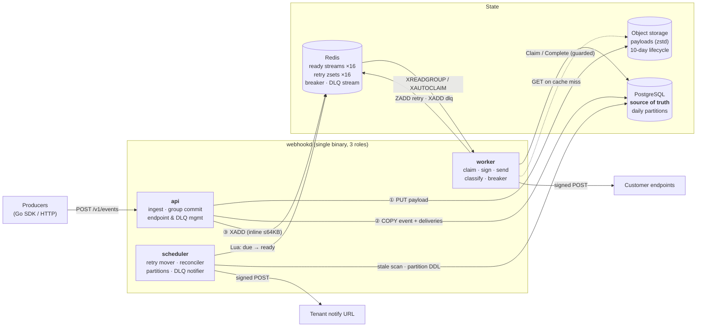
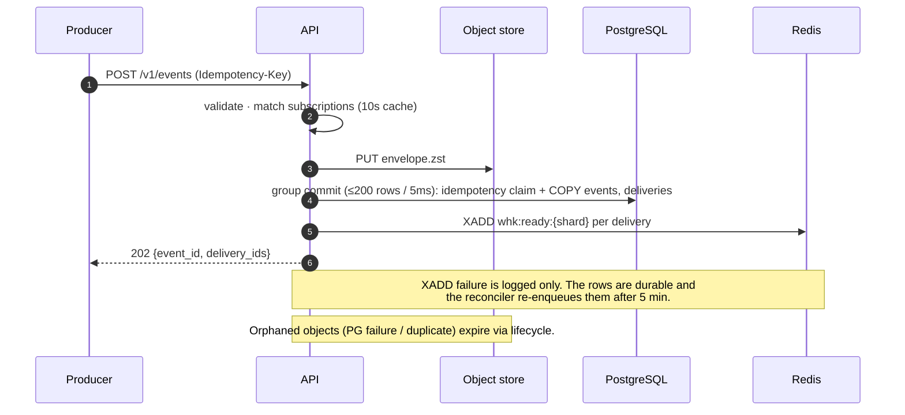
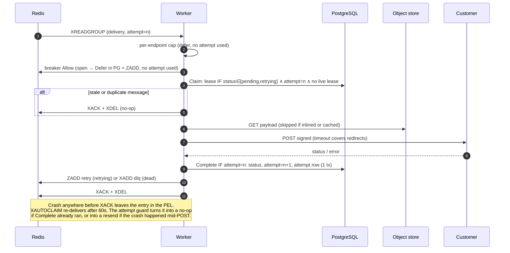
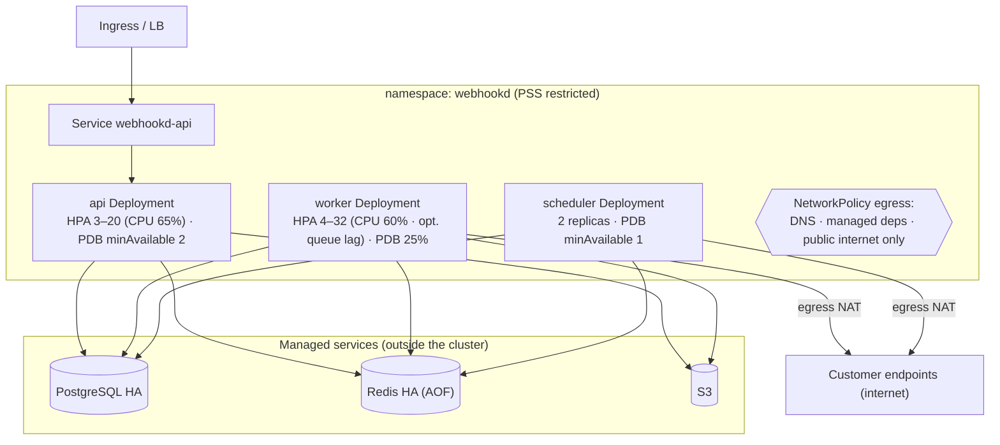
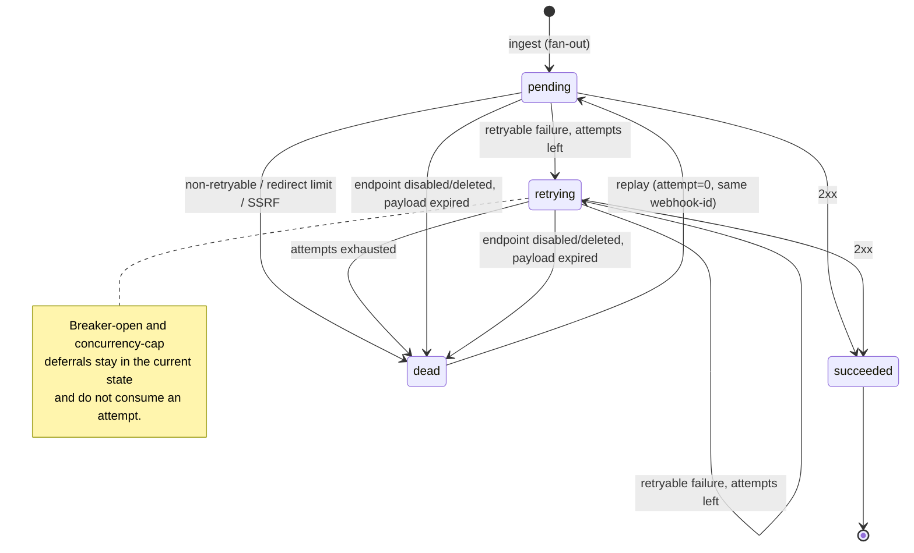

# Reliable Asynchronous Webhook Delivery System — Design Document (v0.4, implemented)

> v0.4: Redis Cluster and PostgreSQL HA (one primary + streaming standbys) client support (§8.2, §8.5). P0-2/3/5 fixed (§17.4).

## 1. Goals and Non-Goals

Goals
- **At-least-once delivery**: once an event is accepted (API returns 202), it reaches a terminal state, either `succeeded` or `dead`.
- **Retries**: exponential backoff with jitter. Retry policy is configurable at three levels: global, tenant, and endpoint.
- **Dead-letter queue (DLQ)**: deliveries go to the DLQ when retries are exhausted. DLQ entries support query, replay, and delete, and tenants are notified.
- **Signing**: HMAC-SHA256 following the Standard Webhooks spec, with Ed25519 reserved for later.
- **End-to-end observability**: Prometheus metrics, structured logs, OpenTelemetry traces, and a per-attempt delivery history.
- **Capacity**: peak 10,000 events/s, 1,000 tenants, payload ≤ 256KB per event.

Non-goals (this phase)
- No ordering guarantee (see §10).
- No admin UI. The system is API only.
- No exactly-once delivery. Receivers must be idempotent on `webhook-id`.

### 1.1 Capacity Assumptions
The real traffic shape is unknown, so sizing assumes an **average payload of 64KB** (configurable assumption, revisit with real data).

| Item | At 10k/s peak, 64KB avg |
|---|---|
| Ingest bandwidth | ~640 MB/s (~5 Gbps) |
| Object-storage PUT rate | 10k/s (keys are hash-prefixed to spread S3 partitions) |
| Payload storage, if the peak were sustained for 10 days | ~550 TB before compression (see §8.3 retention) |
| PG write rate | ~10k event rows/s + ~10k×F delivery rows/s, metadata only (F = fan-out) |

Payloads never live in PostgreSQL, so PG load is independent of payload size.

## 2. Architecture

```
 Producer ──(Go SDK / HTTP)──▶ ┌──────────────┐  ① PUT payload (zstd)  ┌──────────────────┐
                               │  API Server  │───────────────────────▶│ Object Storage   │
                               └──────┬───────┘                        │ (S3 / MinIO)     │
                       ② tx write     │   ③ XADD                       └────────▲─────────┘
                     ┌────────────────┴────────────────┐                        │ GET (on cache miss)
                     ▼                                 ▼                        │
             ┌──────────────┐                ┌───────────────────────┐          │
             │  PostgreSQL  │◀──────────────▶│ Redis                 │          │
             │ (metadata    │  state updates │  Stream  whk:ready:{s}│ ready (16 shards)
             │  source of   │                │  ZSet    whk:retry:{s}│ delayed retries
             │  truth)      │                │  Stream  whk:dlq      │ DLQ notifications
             └──────▲───────┘                │  KV      breaker state│          │
                    │                        └───┬──────────▲────────┘          │
                    │                 XREADGROUP │          │ Lua: move due     │
                    │                            ▼          │                   │
                    │                    ┌──────────────┐ ┌─┴───────────┐       │
                    └────────────────────│   Workers    │─┼─────────────┼───────┘
                     results / attempts  │ (N replicas) │ │ Scheduler   │
                                         └──────┬───────┘ │ + Reconciler│
                                                │         └─────────────┘
                                                │ POST (signed, SSRF-guarded, optional zstd)
                                                ▼
                                       Customer callback URL
```

The system ships as a single binary, `webhookd`. A subcommand selects the role: `api | worker | scheduler | all` (`all` is for local development).

The three stores have separate responsibilities:
- **Object storage** holds payloads.
- **PostgreSQL** is the source of truth for metadata: events, deliveries, attempts, and endpoints.
- **Redis** handles only scheduling. If Redis loses data, the Reconciler rebuilds the queues from PG.

### 2.1 Component View



### 2.2 Ingest Sequence



### 2.3 Delivery Sequence and Failure Points



### 2.4 Failure and Recovery Matrix

| Failure | Detected by | Recovery | Effect |
|---|---|---|---|
| Worker crash mid-delivery | PEL idle > 60s | XAUTOCLAIM by another worker. The lease (timeout + 30s ≤ 60s) has expired by then. | ≤ 1 duplicate POST, ~60s delay |
| Duplicate stream entry (reclaim, reconcile, replay race) | `Claim` attempt guard | Acked as a no-op | None |
| XADD fails after commit | `next_attempt_at` stale > 5 min | Reconciler re-enqueues | ~5 min delay |
| Redis data loss (≤1s with AOF everysec, or total) | Same | Reconciler rebuilds from PG | Delay. No loss. Breaker and notifier state are reset. |
| ZADD retry fails | Same | Same | Delay |
| Object store down at ingest | PUT error | 503 + `Retry-After`. SDK retries with the same idempotency key. | Producer-visible |
| Object store down at delivery | GET error | Lease released, rescheduled in 2–10s, no attempt consumed | Delay |
| Payload expired | GET 404 | Dead (`payload_expired`). Replay returns 410. | Only possible past retention |
| PG primary crash / failover (HA cluster) | Connection errors; standby promoted by the HA manager | Store reconnects to the new writable node (§8.5). Ingest 503s are retried by the SDK with the same idempotency key. Unacked worker messages are reclaimed. | Measured: max 213ms gap in 202s, 0 lost, 0 duplicates (§8.5) |
| PG primary frozen / partitioned | 15s operation timeout, TCP keepalive / user timeout | Connection closed; next attempt finds the new primary | Measured: writes recover in ~20s |
| PG unavailable (no primary) | Errors on every path | Ingest returns 503. Workers stop acking, so messages wait in the PEL. | Full stall until a primary exists (no loss) |
| Customer endpoint down | Retryable failures | Backoff. The breaker opens after 10 failures and defers without consuming attempts. | Bounded load on the customer |

### 2.5 Deployment View (Kubernetes)



## 3. Core Flows

### 3.1 Ingest
1. The producer calls `POST /v1/events` with the tenant API key and an optional `Idempotency-Key` header.
2. The API validates the request: payload ≤ 256KB and a valid event_type.
3. The API resolves subscriptions by `(tenant_id, event_type)` to get the matching endpoints. Results are cached locally with a 10s TTL. If there are no matching endpoints, the API returns 202 with no deliveries and does not store the payload.
4. The payload is compressed with zstd and `PUT` to object storage at key `p/{hash(event_id)[0:2]}/{tenant_id}/{yyyymmdd}/{event_id}.zst`.
5. One PG transaction inserts 1 row into `events` (with `payload_key` and `payload_size`) and N rows into `deliveries` (`status=pending`).
   - `(tenant_id, idempotency_key)` is unique. A duplicate request returns the original event_id. The orphaned object is removed by the lifecycle rule.
6. After commit, the API runs `XADD whk:ready:{shard}` for each delivery, where `shard = hash(endpoint_id) % 16`. The compressed payload is inlined in the message when it is ≤ `inline_threshold` (default **64KB**, configurable).
7. The API returns `202 {event_id, delivery_ids}`.

Failure handling at each step:
- **Step 4 fails**: the API returns 503. Nothing has been accepted, and the SDK retries.
- **Step 5 fails**: the API returns 503. The orphaned object expires via the lifecycle rule.
- **Step 6 fails or the process crashes**: the rows stay `pending` in PG. The Reconciler re-enqueues them, so nothing is lost.

Throughput: PG inserts use group commit (batching up to 5ms or 200 rows). S3 PUTs run concurrently per request.

### 3.2 Worker Consumption and Delivery
```
loop:
  XREADGROUP GROUP workers <consumer> COUNT 64 BLOCK 2s STREAMS whk:ready:{s} >
  for msg:
    if redelivered (delivery_count>1): check PG; if already terminal → XACK, skip
    if breaker open(endpoint): defer to open_until+jitter (no attempt consumed) → ZADD retry, XACK
    if local per-endpoint concurrency limit reached: requeue with short delay (no attempt consumed)
    payload = inline ? msg.payload : cache.Get(event_id) ?? objectStore.Get(payload_key)
    body = decompress(payload); if endpoint.compression==zstd: re-encode for wire
    sign → POST (10s timeout, follow redirects, SSRF check)
    insert delivery_attempts row
    classify:
      2xx                          → UPDATE status=succeeded                        → XACK
      retryable, attempts left     → UPDATE status=retrying, attempt++, next_at → ZADD retry → XACK
      non-retryable, or exhausted  → UPDATE status=dead → XADD whk:dlq              → XACK
```
- **Write order**: PG first, then Redis, then XACK. If a worker crashes at any step, the message stays in the pending entries list (PEL) and is redelivered. The worst case is one duplicate delivery. No message is lost.
- **Crash recovery**: each worker periodically runs `XAUTOCLAIM` on PEL entries idle > 60s. 60s is longer than timeout × max redirects plus a margin.
- **Payload cache**: an in-process LRU cache (default 512MB, configurable) keyed by event_id. It serves fan-out to multiple endpoints and retries that land on the same pod. If the payload object is missing (expired), the delivery goes to dead with reason `payload_expired`.
- **Concurrency**: each shard has one reader goroutine feeding a bounded worker pool (default 1,000 per pod). At 10k/s × 200ms average RT, about 2,000 requests are in flight, which HPA covers with roughly 4–8 pods.
- **Slow-tenant isolation**: a per-pod, per-endpoint concurrency cap (default 50) plus the circuit breaker stop one slow endpoint from taking every slot.

### 3.3 Delayed Retries (Scheduler)
- `whk:retry:{s}` is a ZSet. The member is an encoded `delivery_id|endpoint_id|event_id|attempt` and the score is next_attempt_at in milliseconds.
- Every 200ms, the Scheduler runs a Lua script per shard. In one atomic step it runs `ZRANGEBYSCORE -inf now LIMIT 500`, then `XADD whk:ready:{s}` for each item, then `ZREM`. Because the script is atomic, multiple replicas can run safely without leader election.
- Retry messages never inline the payload. Workers get it from the cache or from object storage. This bounds Redis memory during long receiver outages.

### 3.4 Reconciler (Safety Net)
- A PG advisory lock ensures a single active instance. It runs every 30s.
- It scans for rows with `status IN (pending, retrying) AND next_attempt_at < cutoff` and no live lease, and re-enqueues them into the ready queue without inlining payloads. This covers Redis data loss and failed XADDs.
- **Backlog gate.** `cutoff = min(now − 5min, oldest outstanding work in Redis − 30s)`, floored at `now − 30min`. "Oldest outstanding work" is the minimum, over all shards, of the oldest pending entry, the oldest entry not yet delivered to the group, and the oldest overdue retry.
  - **Why it is safe:** streams are FIFO. A delivery scheduled before the oldest work still in the queue cannot be waiting in that queue, so its message must have been lost.
  - **Without the gate:** a backlog older than 5 minutes would be re-enqueued in full on every 30s pass.
  - **The 30-minute floor:** a single stuck entry can't switch reconciliation off. During a backlog longer than 30 minutes, entries are re-enqueued at most once per 30 minutes, and `Claim` turns each copy into a no-op.
  - **If Redis can't be read,** the pass is skipped.
  - `webhook_reconcile_gated_total` counts gated passes.

### 3.5 DLQ and Notifications
- **DLQ record**: `deliveries.status=dead` is the authoritative DLQ record, and it supports query and replay. The worker also writes an entry to the `whk:dlq` stream (MAXLEN ~1M) for the notifier.
- **Notifications**: a tenant configures a notification URL. The system sends a signed `webhook.delivery.dead` event to it.
  - Notifications are aggregated per endpoint, at most one per 10 minutes, carrying a count.
  - The notification itself is retried up to 3 times. It never enters the DLQ, which avoids recursion.
  - Email and IM channels are out of scope.
- **Replay**: `POST /v1/dlq/{delivery_id}/replay`, or a bulk replay by filter.
  - Replay resets attempt to 0, sets status to `pending`, and re-enqueues the delivery.
  - `webhook-id` stays the same, so receivers can deduplicate.
  - If the payload has expired, replay returns `410 Gone`.

## 4. State Machine



```
            ┌──────────── replay ─────────────┐
            ▼                                 │
 pending ──deliver──▶ succeeded               │
    │                                         │
    └─fail(retryable)─▶ retrying ──due──▶ deliver ──▶ succeeded
                           ▲                  │
                           └─fail(retryable,  │
                              attempts left)  │
                                              ▼
            fail(non-retryable) or attempts exhausted ──▶ dead
```
- When an endpoint is disabled or deleted, its in-progress deliveries move to `dead` with reason `endpoint_disabled`. They can be replayed manually after the endpoint is re-enabled.
- Deferrals caused by the breaker or the concurrency cap do not count as attempts.
- Dead reasons: `exhausted`, `non_retryable_status`, `too_many_redirects`, `ssrf_blocked`, `endpoint_disabled`, `payload_expired`.

## 5. Retry Policy

```
delay(n) = min(max_delay, base_delay × multiplier^(n-1))      n = retry number, 1-based
jitter:
  full  : rand[0, delay]
  equal : delay/2 + rand[0, delay/2]   ← default; avoids near-zero delays
if Retry-After present (429/503): delay = max(delay, min(retry_after, max_delay))
```

| Parameter | Default | Configurable at |
|---|---|---|
| max_attempts | 15 (incl. first) | global / tenant / endpoint (closest level wins) |
| base_delay | 5s | same |
| multiplier | 2.0 | same |
| max_delay | 1h | same |
| jitter | equal | same |
| timeout | 10s | same (max 30s) |
| max_redirects | 3 | same (max 10) |

With these defaults there are 14 retries: 5s, 10s, …, 2560s, then 4 × 1h. The nominal total window is about 5.4h. Equal jitter shortens the actual window to between half of that and the full value.

Validation rule: the nominal total window of a policy must be ≤ 72h. This keeps every in-flight delivery inside payload retention (§8.3).

Result classification

| Result | Action |
|---|---|
| 2xx | Success |
| Timeout, connection, DNS, or TLS error | Retry |
| 408, 429, 5xx | Retry |
| 3xx | Follow the redirect. Exceeding max_redirects is a non-retryable failure. |
| Other 4xx | No retry, delivery goes to dead |
| SSRF blocked | No retry, delivery goes to dead |

Redirect rules
- Every hop is re-validated against SSRF rules.
- Downgrading from https to http is rejected.
- **All 3xx responses, including 301/302/303, keep the POST method, the body, and all webhook headers.** The signature does not cover the URL, so it remains valid after a redirect.

## 6. Signing (Standard Webhooks)

Request headers
```
webhook-id:        msg_<ulid>              # = delivery_id; stable across retries/replays
webhook-timestamp: <unix seconds>          # refreshed on each attempt
webhook-signature: v1,<base64(HMAC-SHA256(secret, "{id}.{timestamp}.{body}"))>
content-type:      application/json
content-encoding:  zstd                    # only when endpoint.compression = zstd
user-agent:        webhookd/1.0
```
- **Secrets**: one per endpoint, in the form `whsec_<base64(32B)>`. Secrets are stored in PG encrypted with AES-256-GCM. The master key comes from an environment variable or a K8s Secret.
- **Rotation**: `POST /v1/endpoints/{id}/secret/rotate`. The old secret stays valid for 24h (configurable). During that window the signature header carries both signatures, space-separated: `v1,<new> v1,<old>`.
- **Ed25519**: `Signer` is an interface, and the spec reserves the prefix `v1a,<base64(ed25519 sig)>`. This phase implements HMAC only. The `endpoints` table has a `sign_alg` column reserved for the switch.
- **Compression and signing**: the signature is computed over the **uncompressed** body. Receivers decompress first and then verify, which matches how HTTP middleware typically decodes `Content-Encoding` before handlers run. `Verify` in the SDK also handles this.
- **Receiver verification**: the SDK provides `Verify(secret, headers, body, tolerance=5m)`, which checks the signature and rejects replays outside the time window.
- Note: HMAC proves only that the sender holds the shared secret. It does not provide strict non-repudiation. Enable Ed25519 when non-repudiation is required.

## 7. SSRF Protection
- **At registration**: the scheme must be https (http can be allowed by config for development), and userinfo in the URL is rejected. Any port is allowed.
- **At dial time**: a custom `net.Dialer.Control` checks the final resolved IP, which defeats DNS rebinding. Blocked ranges:
  - loopback, private (RFC1918), link-local (including 169.254.169.254)
  - CGNAT 100.64/10, multicast, unspecified
  - IPv6 ULA and link-local, and IPv4-mapped addresses
- A configurable allowlist is available for test environments.

## 8. Data Model

### 8.1 PostgreSQL (metadata only)

Authoritative DDL: `internal/store/schema.sql`. It is applied idempotently on startup under an advisory lock.

```sql
tenants(id PK, name, api_key_hash UNIQUE,            -- SHA-256 hex of the API key; plaintext never stored
        notify_url, notify_secret_enc bytea,         -- AES-GCM, AAD = tenant id
        retry_policy jsonb, created_at)

endpoints(id PK, tenant_id FK, url, description, event_types text[],  -- '*', exact, or 'prefix.*'
          status ('active'|'disabled'|'deleted'),    -- 'deleted' = soft delete
          sign_alg ('hmac-sha256'), compression ('none'|'zstd'),
          secret_enc bytea, prev_secret_enc bytea, prev_secret_expires_at,  -- AES-GCM, AAD = endpoint id
          retry_policy jsonb, max_concurrency int,   -- 0 = server default
          created_at, updated_at)
  INDEX (tenant_id) WHERE status <> 'deleted'

-- created_at = timestamp embedded in the ULID id (enables partition pruning by id)
events(id, tenant_id, event_type, payload_key, payload_size, stored_size,
       idempotency_key, trace_parent, created_at)
  PK (id, created_at)                                -- PARTITION BY RANGE (created_at), daily

deliveries(id, event_id, endpoint_id, tenant_id, status, attempt,
           next_attempt_at, lease_until,             -- lease_until: set by Claim while a worker owns it
           last_status_code, last_error, dead_reason, created_at, updated_at, completed_at)
  PK (id, created_at)                                -- daily partitions
  INDEX (next_attempt_at) WHERE status IN ('pending','retrying')   -- reconciler
  INDEX (tenant_id, status, id)                      -- list / DLQ queries
  INDEX (event_id)

delivery_attempts(delivery_id, attempt, started_at, duration_ms, status_code,
                  error, response_body, redirects)   -- response_body ≤ 4KB, sanitized
  INDEX (delivery_id, attempt)                       -- PARTITION BY RANGE (started_at), daily

idempotency_keys(tenant_id, key, day date, event_id, created_at)
  PK (tenant_id, key, day)                           -- PARTITION BY RANGE (day); 24h window spans 2 days
```

Writes:
- **Ingest**: one transaction per group-commit batch (≤200 events / 5ms). It claims idempotency keys with `INSERT … ON CONFLICT DO NOTHING` in sorted key order, then `COPY`s events and deliveries.
- **Worker**: `Claim` is one UPDATE with a guard. `Complete` is one transaction: a guarded UPDATE of the delivery plus an INSERT of the attempt row.
- **Retention**: the scheduler creates partitions 3 days ahead every hour and `DROP`s expired ones. Rows are never DELETEd.

### 8.2 Redis
Every multi-key command and Lua script keeps its keys in one Redis Cluster slot:
- **Queue:** `{s}` tags each shard's stream and zset.
- **Breaker:** `{endpoint_id}` tags both of an endpoint's keys.
- **Notifier:** `{ntf<s>}` tags an endpoint's window hash and its shard's due zset, where s = the endpoint's queue shard.

`test/cluster` runs every Redis path against a real Cluster node, which rejects cross-slot access with CROSSSLOT. In addition, the **entire** default suite (67 tests, including the full-pipeline integration tests) passes with `WEBHOOKD_IT_REDIS_MODE=cluster`, which points every test's Redis client at the Cluster node.

Topology is set by `WEBHOOKD_REDIS_ADDR`, a comma-separated list, through go-redis `UniversalClient`:
- one address: standalone
- `WEBHOOKD_REDIS_MASTER_NAME` set: Sentinel
- several addresses, or `WEBHOOKD_REDIS_CLUSTER=true`: Cluster

| Key | Type | Fields / encoding |
|---|---|---|
| `whk:ready:{s}` (s = 0..15) | Stream, group `workers` | `d`=delivery_id, `e`=endpoint_id, `v`=event_id, `a`=attempts made (decimal string), `p`=zstd envelope bytes (only on first enqueue when ≤ 64KB) |
| `whk:retry:{s}` | ZSet | member `delivery_id\|endpoint_id\|event_id\|attempt`, score = due time (Unix ms). Never carries the payload. |
| `whk:dlq` | Stream, group `notifier` | `t`=tenant_id, `e`=endpoint_id, `d`=delivery_id, `r`=dead_reason. `MAXLEN ~ 1,000,000`. |
| `whk:cb:{<endpoint_id>}` | Hash, TTL ≥ 1h | `fails`, `open_until` (Unix ms), `opens` (for doubling) |
| `whk:cbprobe:{<endpoint_id>}` | String, `SET NX PX` | Single half-open probe token |
| `whk:notify:{ntf<s>}:<endpoint_id>` | Hash, TTL 3 × window | `tenant`, `count`, `start` (Unix ms), `reason`, `sample` (delivery_id) |
| `whk:notify:due:{ntf<s>}` (s = 0..15) | ZSet | member = endpoint_id, score = window end (Unix ms). The flusher scans each shard. |

Processed entries are removed with `XACK` + `XDEL` in one pipeline, so stream memory tracks backlog, not history. Durability is AOF `appendfsync everysec`. Losing Redis data delays deliveries but never loses them (§2.4).

### 8.3 Object Storage and Retention

| Data | Retention | Mechanism |
|---|---|---|
| Payload objects | 10 days after creation: 72h max policy window + 7-day replay window | S3 lifecycle expiration rule |
| events / deliveries / delivery_attempts | 30 days | Drop daily partitions |

- Object keys are prefixed with a hash, `p/{2 hex}/...`, to spread load across S3 partitions at 10k PUT/s.
- Objects are written once and never modified.

### 8.4 Serialization Formats

| Data | Format | Code |
|---|---|---|
| IDs | `<prefix>_<ULID>`: 26 chars Crockford base32, with a 48-bit ms timestamp prefix. Prefixes: `ten`, `ep`, `evt`, `msg` (delivery = `webhook-id`), `ntf`. The timestamp becomes `created_at`. | `model.NewID`, `model.IDTime` |
| Event envelope (receiver body) | JSON `{"type", "timestamp" (RFC 3339 UTC), "data"}`. `data` is the producer's raw JSON (`json.RawMessage`) and is not re-encoded. Built once at ingest. | `ingest.envelope` |
| Stored payload | zstd (`klauspost/compress`, SpeedDefault) of the envelope. Content-Type `application/zstd`. Decompression is capped at max payload + 64KB. | `payload.Compress` / `Decompress` |
| Object key | `p/{hex(sha256(event_id))[0:2]}/{tenant_id}/{yyyymmdd}/{event_id}.zst` | `payload.Key` |
| Wire body | `none` endpoints get the uncompressed envelope. `zstd` endpoints get the stored bytes unchanged, with `Content-Encoding: zstd`. The signature always covers the uncompressed envelope. | `dispatch.Worker.process` |
| Signature header | `v1,` + base64(HMAC-SHA256(key, `"{webhook-id}.{webhook-timestamp}.{body}"`)), where key = base64-decode of the secret without `whsec_`. Space-separated during rotation. | `pkg/webhook` |
| Secrets | Plaintext form `whsec_` + base64(32 random bytes). At rest: `nonce(12B) ‖ AES-256-GCM(ciphertext+tag)`. AAD = row owner ID (endpoint ID or tenant ID), so ciphertexts can't be swapped between rows. | `internal/secretbox` |
| API keys | Plaintext `whk_` + base64url(32B), returned once. Only `sha256` hex is stored. | `store.HashAPIKey` |
| Retry policy | JSON with optional fields, where absent means inherit. Durations are Go duration strings (`"5s"`) via `model.Duration`. Stored as jsonb. | `model.RetryPolicy` |
| Trace context | W3C `traceparent` string, stored on the event and used as a span link at delivery time | `telemetry.TraceParent` / `LinkFrom` |
| Management API | JSON from `internal/model` struct tags. Secrets are tagged `json:"-"` and only appear in the create/rotate response. | `internal/api`, `docs/openapi.yaml` |

In-memory only, not persisted: payload LRU (512MB per worker pod), worker endpoint and policy cache (5s), subscription cache (10s), API-key auth cache (30s).

### 8.5 PostgreSQL HA Client (one primary, N streaming standbys)

Target topology: Patroni, RDS Multi-AZ, Aurora, or Cloud SQL HA. Exactly one writable node, standbys on streaming replication.

**Configuration.** `WEBHOOKD_POSTGRES_DSN` lists every node:

```
postgres://webhookd:…@pg-0:5432,pg-1:5432,pg-2:5432/webhookd?sslmode=verify-full
```

A single endpoint that always points at the primary also works: a Patroni/HAProxy VIP, the RDS/Aurora writer endpoint, or a K8s Service with a role selector.

**What the store does** (`internal/store/ha.go`):

| Concern | Behavior | Why |
|---|---|---|
| Node selection | Every new connection is validated with `transaction_read_only = off` (libpq `target_session_attrs=read-write`). If the DSN sets any other `target_session_attrs`, startup is refused. | Host order is static, so after a failover a standby is listed first. libpq's default (`any`) would then connect to it. |
| Dead host | `connect_timeout` 5s per host, then the next host is tried | Bounded failover discovery |
| Frozen or partitioned primary | Every store call has a 15s deadline (DDL 2 min). TCP keepalive 10s/5s×3 and `TCP_USER_TIMEOUT` 20s (Linux). | Otherwise a hung node hangs workers indefinitely |
| Demotion without restart | A query tracer resets the pool on SQLSTATE 25006 (read-only transaction), at most once per second. New connections are then validated again. | Pooled sessions to the old primary stay connected and would be reused forever |
| Rebalancing | `MaxConnLifetime` 30 min + 5 min jitter | Connections drift back after topology changes |
| In-flight transaction during failover | It fails. Ingest returns 503, and the SDK retries with the same `Idempotency-Key`. The worker doesn't ack, so the message is reclaimed. Complete/Claim guards dedupe. | At-least-once holds without any special path |

**Requirement on the cluster: synchronous replication.** Set `synchronous_commit = on` (or `remote_apply`) with at least one synchronous standby, e.g. Patroni `synchronous_mode: true`.
- A 202 means the event is committed. With asynchronous replication, a commit acknowledged just before the primary crashes can be lost when the standby is promoted. The event is then gone even though the producer saw 202.
- Every read and write goes to the primary. Standbys are for availability only, so replica lag never shows up in the API (no read-your-writes anomalies).

**Verified** (`test/integration/pgha_test.go`, two-node cluster from the compose `ha` profile, synchronous replication, real promotions):

| Test | Scenario | Result |
|---|---|---|
| `TestPGHAStandbyListedFirst` | Standby first in the DSN; run migrations + writes | Before fix: `CREATE TABLE in a read-only transaction`. After: pass. |
| `TestPGHADemotedPrimaryWithoutRestart` | Old primary fenced to read-only while connected, standby promoted | Before fix: writes failed for the whole 15s window. After: first write fails with 25006, recovered in ~70ms. |
| `TestPGHAFailoverEndToEnd` | Full pipeline under load; primary SIGKILLed, standby promoted | 941 accepted, 941 delivered, 0 duplicate requests, max gap between successful publishes 213ms |
| `TestPGHAFrozenPrimary` | Primary paused (alive, unresponsive), standby promoted | Writes recover in ~20s (operation timeout 15s + connect 5s) |

In addition, the whole suite (67 tests) passes against the HA cluster with the standby listed first, together with Redis Cluster.

## 9. Circuit Breaker
- An endpoint opens after ≥ 10 consecutive failures (configurable). It stays open for 60s, and each subsequent opening doubles the duration, up to 30min.
- While the breaker is open, messages for that endpoint are deferred without being sent, and no attempt is counted.
- In half-open state, a single probe is allowed. Success closes the breaker; failure re-opens it.
- Breaker state lives in Redis and is shared by all workers.

## 10. Ordering (Not Guaranteed in This Phase)
Retries, concurrent workers, and sharding all reorder messages. Strict per-endpoint FIFO would require delivering to each endpoint serially and blocking later messages behind a failing one (head-of-line blocking). That sharply lowers the throughput ceiling and lets one broken endpoint affect much more traffic.

A possible later option is an opt-in `ordered=true` mode per endpoint: at most 1 request in flight, and later messages block while one is failing.

Current approach: the payload carries a `timestamp`, and receivers reorder if they need to.

## 11. Observability

Metrics (Prometheus `/metrics`)
- `webhook_events_ingested_total{tenant}`: no event-type label, because types are producer-controlled and unbounded
- `webhook_ingest_payload_bytes` (histogram)
- `webhook_delivery_attempts_total{result,status_class}`
- `webhook_delivery_duration_seconds` (histogram)
- `webhook_delivery_e2e_latency_seconds`: time from event creation to success
- `webhook_deliveries_dead_total{reason}`
- `webhook_queue_lag{shard}`: XINFO GROUPS lag plus PEL size
- `webhook_retry_backlog{shard}`
- `webhook_payload_cache_hits_total`, `webhook_payload_fetch_duration_seconds`, `webhook_objectstore_errors_total{op}`
- `webhook_circuit_transitions_total{to}` (open | closed): no endpoint label. A breaker is usually opened by one pod and closed by another, so a per-endpoint gauge would leave stale series behind. Endpoint IDs are in the `circuit opened/closed` log lines.
- `webhook_reconcile_gated_total`, `webhook_reconciled_total`

Cardinality control: every label comes from a closed set, except `tenant` (bounded at 1,000 by requirement), and no metric carries an endpoint label. `internal/metrics` has a test that fails if a label outside the allowlist is registered.

Traces
- Ingest creates an `ingest` span, with child spans for the S3 PUT and the PG transaction. The `traceparent` is stored in the `events` table.
- The worker's `deliver` span links back to the original trace.
- Whether to send a `traceparent` header on outbound requests is configurable per endpoint. The default is off.

Logs: `log/slog` JSON with fixed fields `event_id, delivery_id, endpoint_id, tenant_id, attempt`.

Delivery history: `GET /v1/deliveries/{id}/attempts`.

Grafana: one dashboard JSON is provided.

## 12. API Surface
Authentication uses `Authorization: Bearer <tenant_api_key>`, and PG stores only the SHA-256 hash of each key. A separate admin key is used to create tenants. ⚠ RBAC and mTLS are out of scope for this phase.

```
POST   /v1/events                         # publish an event
GET    /v1/events/{id}                    # event with per-delivery status
POST   /v1/endpoints                      # register (secret returned once)
GET    /v1/endpoints | /v1/endpoints/{id}
PATCH  /v1/endpoints/{id}                 # url / event_types / retry_policy / compression / status
DELETE /v1/endpoints/{id}
POST   /v1/endpoints/{id}/secret/rotate
GET    /v1/deliveries?status=&endpoint_id=
GET    /v1/deliveries/{id}/attempts
GET    /v1/dlq?endpoint_id=&since=
POST   /v1/dlq/{delivery_id}/replay       # 410 if payload expired
POST   /v1/dlq/replay                     # bulk replay by filter (async)
DELETE /v1/dlq/{delivery_id}
PUT    /v1/tenant/notify                  # set notification URL
POST   /admin/v1/tenants                  # admin
GET    /healthz  /readyz  /metrics
```

The Go SDK (`pkg/sdk`) provides:
- `Client.SendEvent`, with built-in retries and automatic idempotency keys
- Endpoint and DLQ management calls
- `webhook.Verify` for receivers, which handles zstd decoding

## 13. Deployment
- **docker-compose** (`deploy/docker-compose.yml`):
  - Default services: postgres, redis (AOF, `appendfsync everysec`), minio (lifecycle rule), api, 2 × worker, scheduler, mock receiver.
  - Profile `test`: `redis-cluster`, a single-node Redis Cluster on port 47000. It enforces CROSSSLOT like a real cluster.
  - Profile `ha`: `pg-a` and `pg-b`, a two-node PostgreSQL HA cluster with a synchronous streaming standby. Roles are elected at start by `deploy/pg-ha/entrypoint.sh`. For failover tests only; it has no fencing or automatic failover.
- **K8s manifests** (`deploy/k8s/`, kustomize):
  - api: Deployment + Service + HPA on CPU
  - worker: Deployment + HPA on CPU, optionally on the lag external metric
  - scheduler: Deployment with 2 replicas
  - ConfigMap, with Redis Cluster mode on by default
  - Secret template: multi-host PG DSN, Redis seed nodes, S3, master key, admin key
  - PodDisruptionBudgets, egress NetworkPolicy, restricted Pod Security
  - Graceful shutdown: stop reading new messages and drain in-flight requests, up to 30s
  - PG (HA: one primary + synchronous standby, §8.5), Redis Cluster, and S3 are assumed to be managed services and are not included in the manifests
- **Connection configuration:**
  - `WEBHOOKD_POSTGRES_DSN`: every PG node, or one writer endpoint (§8.5)
  - `WEBHOOKD_REDIS_ADDR`: seed nodes, plus `WEBHOOKD_REDIS_CLUSTER=true` or `WEBHOOKD_REDIS_MASTER_NAME` for Sentinel (§8.2)
- **Layout**:
  ```
  cmd/webhookd/          main (roles: api | worker | scheduler | all)
  cmd/mockreceiver/      receiver for e2e/load tests (verifies signatures, counts duplicates)
  internal/api/          HTTP routes, auth
  internal/ingest/       ingest, fan-out, group commit
  internal/dispatch/     worker, HTTP sender, result classification
  internal/retry/        backoff, policy merge and validation
  internal/scheduler/    retry mover, reconciler (+ backlog gate), partitions, queue stats
  internal/notify/       DLQ notifications
  internal/breaker/      circuit breaker (Redis)
  internal/queue/        Redis Stream / ZSet wrappers
  internal/store/        PostgreSQL access, HA client policy (ha.go)
  internal/payload/      object store client, zstd, byte-bounded LRU
  internal/secretbox/    AES-256-GCM for secrets at rest
  internal/ssrf/         URL validation + dial-time checks
  internal/model/        domain types
  internal/config/       env configuration
  internal/metrics/      Prometheus metrics (+ label allowlist test)
  internal/telemetry/    slog JSON, OpenTelemetry
  internal/testenv/      isolated real dependencies for tests
  pkg/webhook/           Standard Webhooks sign/verify
  pkg/sdk/               Go client SDK
  deploy/                Dockerfile, compose, pg-ha scripts, k8s, grafana
  test/integration/      full-pipeline and PG failover tests
  test/cluster/          Redis Cluster compatibility tests
  test/e2e/              e2e script against the compose stack
  test/load/             load generator
  docs/                  design.md, openapi.yaml
  ```
- **Dependencies** (pinned in `go.mod`): `go-redis/v9`, `pgx/v5`, `chi/v5`, `minio-go/v7`, `klauspost/compress` (zstd), `prometheus/client_golang`, `otel` + OTLP gRPC exporter, `oklog/ulid/v2`, `golang.org/x/sync` (singleflight), `golang.org/x/sys` (TCP_USER_TIMEOUT). The LRU is built in, and tests use docker-compose rather than testcontainers (§16).

## 14. Test Plan
- **Unit tests**:
  - Backoff and jitter bounds, the max_delay cap, Retry-After handling, the 72h policy window validation
  - Policy merge, result classification, signing (against the official Standard Webhooks test vectors), Verify (plain and zstd)
  - SSRF address classes
  - Breaker state transitions
- **Integration tests** (real PG + Redis + MinIO from docker-compose, an in-process pipeline, and programmable receivers):
  - Success on the first attempt
  - 5xx several times, then success
  - Persistent timeout until the delivery goes to the DLQ
  - 400 goes straight to the DLQ
  - 429 with Retry-After
  - 301/302/303/307/308 each keep POST and the body, and the redirect limit is enforced
  - Payload above and below the inline threshold
  - zstd endpoint
  - Worker killed mid-delivery: XAUTOCLAIM takes over and nothing is lost
  - Redis flushed: the Reconciler recovers
  - Replay keeps the same webhook-id
  - Replay of an expired payload returns 410
  - No requests are sent while the breaker is open
  - The reconciler does not re-enqueue a backlog that is merely waiting
- **Redis Cluster**:
  - `test/cluster` covers queue, breaker, and notifier against a Cluster node.
  - The whole suite also runs with `WEBHOOKD_IT_REDIS_MODE=cluster`.
- **PostgreSQL HA** (opt-in, `WEBHOOKD_IT_PG_HA=1`):
  - standby listed first in the DSN
  - primary demoted without restart
  - primary SIGKILLed under full-pipeline load
  - primary frozen
  - The whole suite also runs with a standby-first multi-host DSN.
- **E2E**: docker-compose brings up the full stack, and a script demonstrates the end-to-end flow.
- **Load test**: a Go load generator in `test/load` runs against the mock receiver with configurable payload sizes. It reports throughput, P99, and an eventual-consistency check (sent = succeeded + dead). ⚠ Local hardware will not reach 10k/s × 64KB (5 Gbps). The report gives measured numbers plus a per-pod linear-scaling estimate.

## 15. Decisions Log
| # | Decision |
|---|---|
| 1 | All 3xx responses keep POST and the body. Max redirects is 3 by default. |
| 2 | DLQ notifications go only to the tenant notification URL, as a signed webhook. |
| 3 | Payloads live in object storage (MinIO/S3). PG stores metadata only. The inline threshold is 64KB. Average payload size is unknown, so 64KB is assumed. |
| 4 | API auth: tenant API key + admin key. |
| 5 | Retry defaults: 15 attempts, base 5s, ×2, max 1h, equal jitter (~5.4h nominal window). |
| 6 | Payload retention is 10 days. Metadata retention is 30 days. |
| 7 | Outbound zstd compression is a per-endpoint option. The signature covers the uncompressed body. |

## 16. Implementation Notes (deviations from v0.2)

| Area | v0.2 design | As implemented | Why |
|---|---|---|---|
| Duplicate suppression | Worker checks PG only for redelivered messages | Every message is claimed in PG: `Claim` sets `lease_until` only if `status ∈ {pending, retrying}`, `attempt` matches, and no live lease. `Complete` uses the same attempt guard. | Duplicate stream entries (reclaim, reconciler, replay) become no-ops at the DB. This is what keeps at-least-once from turning into many-times. |
| Partition keys | Not specified | `created_at` equals the ULID timestamp in the ID. Primary keys are `(id, created_at)`. | Point lookups by ID can prune to one daily partition. |
| Breaker deferral | ZADD retry only | ZADD retry **and** `Defer` (moves `next_attempt_at` in PG) | Otherwise the reconciler re-enqueues long-deferred deliveries. |
| Transient payload fetch failure | Not specified | The worker releases its lease and reschedules in 2–10s. No attempt is consumed. | An object-storage outage must not exhaust customers' retries. |
| Request body | "payload" | Envelope `{"type","timestamp","data"}`, built once at ingest and stored zstd. zstd endpoints receive the stored bytes as-is. | One compression per event, and a self-describing body for receivers. |
| Stream trimming | `XTRIM MINID` | `XACK` + `XDEL` per message | Simpler and exact. Memory tracks backlog. |
| Idempotency | Unique `(tenant_id, idempotency_key)` on `events` | Separate `idempotency_keys` table, partitioned by day, with a 24h window | A global unique index across event partitions isn't possible in PG. |
| Bulk replay | Async job | Synchronous, ≤1000 per call. The caller loops until `replayed = 0`. | No job infrastructure is needed, and the call is bounded. |
| DLQ notification | 1 per 10 min | Leading + trailing: the first dead is reported immediately, and the rest of the window is sent as one summary. The tenant gets a dedicated signing secret from `PUT /v1/tenant/notify`. | Prompt first signal, with the rate still bounded. |
| Endpoint delete | Move in-flight deliveries to dead | Soft delete (`status=deleted`). Workers dead-letter in-flight deliveries lazily with `endpoint_disabled`. | No fan-out update on delete. History stays queryable. |
| No subscribers | Not specified | 202 with empty `delivery_ids`. Nothing is stored. | Saves S3 and PG writes. |
| Breaker inputs | "consecutive failures" | Only retryable failures count. Any non-transient HTTP response closes the breaker. Redis errors fail open. | A 4xx means the endpoint is up. The breaker is an optimization, never a gate. |
| Timeout scope | Per request | Per attempt, covering all redirect hops | Bounds lease time and XAUTOCLAIM idle. |
| Policy validation | — | `base_delay ≥ 1s`, `timeout ≤ 30s`, `max_redirects ≤ 10`, nominal window ≤ 72h | Keeps deliveries within payload retention. |
| Tracing | — | Parent-based sampling at 10%. Export is enabled by `WEBHOOKD_OTLP_ENDPOINT`. | Bounded overhead at 10k/s. |
| Test dependencies | testcontainers-go | docker-compose services + `internal/testenv` (fresh DB, Redis prefix, and bucket per test) | Rootless podman. The same compose file also serves e2e, Cluster, and HA topologies. |
| Payload cache | `hashicorp/golang-lru` | Built-in byte-bounded LRU + singleflight | The LRU must bound bytes, not entries, since payloads range from 1KB to 256KB. |
| Signing package | `internal/signing` | `pkg/webhook` | Public, so receivers and the SDK share the verifier |
| Redis topology | Single Redis | Standalone, Sentinel, or Cluster via `UniversalClient`. Every script is single-slot. | The production Redis is a Cluster. |
| PostgreSQL topology | Single PG | HA client: multi-host DSN, read-write targeting, bounded operations, pool reset on demotion (§8.5) | The production PostgreSQL is one primary + streaming standbys. |

### 16.1 Verification results (local, single host)

Totals: **71 tests** = 34 unit + 33 integration (default suite, real dependencies) + 4 opt-in PG failover tests.
- **Unit tests:**
  - retry, signing (Standard Webhooks vector), SSRF, secretbox, payload, sender
  - The sender tests cover all 3xx codes, the redirect limit, an https→http redirect, Retry-After, timeouts, and the dial-time SSRF block.
- **Integration tests:** 33 tests against real PG, Redis, MinIO, and a single-node Redis Cluster (`WEBHOOKD_IT=1`), covering every scenario in §14. The default suite passes in three configurations:
  - standalone PG + standalone Redis
  - standalone PG + Redis Cluster
  - PG HA (standby-first DSN) + Redis Cluster
- **PG failover tests:** 4 tests pass (§8.5). The worst case is a hard primary kill under load: 941/941 delivered, 0 duplicates, max publish gap 213ms.
- **Other integration coverage:** It includes a consumer crash (XAUTOCLAIM), a full Redis queue loss (reconciler), replay of an expired payload (410), breaker deferral without consuming attempts, and dual signatures during secret rotation.
- **E2E:** `test/e2e/e2e.sh` against the compose stack (separate api, 2 workers, scheduler) passes 9 checks.
- **Load** (`test/load`, 4KB payloads, single API process, single local MinIO):

| Target | Achieved | Ingest p99 | Notes |
|---|---|---|---|
| 3,000/s | 3,000/s | 28 ms | S3 PUT 2 ms, PG commit 5 ms |
| 4,000/s | 4,000/s | 188 ms | |
| 8–10k/s | ~5,000/s | 420–475 ms | Bound by the single local MinIO (900% CPU, PUT 170 ms → 950 ms) |

  - In every run, every accepted delivery reached a terminal state, with 0 bad signatures and 0 duplicate deliveries after a 2xx.
  - Raising minio-go's idle pool from 16 to 1024 per host moved the ceiling from ~2k/s to ~5k/s.
  - PG (≤15 ms commits) and Redis (<10 ms) were not the bottleneck.
  - **Production estimate:** 10k/s needs ≥3 API pods and S3 (or a distributed MinIO) sized for 10k PUT/s, already a requirement in §1.1. This is an estimate from scaling the measured ~4k/s per pod linearly; it was not measured here.

## 17. Scope Boundaries and Production Readiness

This section separates three things: what was engineered in depth, what was deliberately simplified, and what is still missing before production. Every claim below names the code or test that backs it, or is marked as unverified.

### 17.1 Trade-off Summary

| Decision | Chosen | Rejected alternative | Why |
|---|---|---|---|
| Source of truth | PostgreSQL. Redis only schedules. | Redis-only, as both queue and state | Redis AOF `everysec` can lose ~1s, and Redis memory can't hold 10 days of history. With PG as truth, losing Redis means delay, never loss. |
| Queue | Redis Streams + consumer groups, 16 shards | Kafka | Per-message ack, PEL, and XAUTOCLAIM give per-delivery retry semantics with no extra infrastructure. Kafka's offset model needs a separate retry topic per delay tier. |
| Delayed retry | ZSet + atomic Lua mover | Per-delay retry streams, DB polling | Arbitrary per-endpoint delays, O(log n), no leader election |
| Dedup point | PG `Claim` with attempt guard + lease | Redis `SETNX` dedup keys | The guard sits on the record being changed, so a duplicate can't slip in between the check and the update. Costs one extra PG write per attempt (§17.4, P0-1). |
| Payload storage | Object storage, zstd, inline ≤64KB in the stream | PG `bytea`, or Redis only | 100–256KB × 10k/s rules out PG. Inlining saves a GET on the hot path. Retries never inline, so Redis memory stays bounded during outages. |
| Ingest durability | S3 PUT + PG commit **before** 202 | Ack after Redis XADD only | A 202 is a promise. The cost is that ingest latency is bound to S3 latency (measured, §16.1). |
| Ordering | None | Per-endpoint FIFO | FIFO means head-of-line blocking, and one broken endpoint stalls its whole stream (§10). |
| Exactly-once | No. At-least-once + stable `webhook-id`. | Two-phase delivery | Exactly-once is impossible over HTTP to a third party. The best available is to minimize duplicates and make deduplication easy for receivers. |
| Breaker scope | Shared in Redis, retryable failures only | Per-pod in memory | N pods with local breakers would each send failing traffic, multiplying the load on a struggling customer by N. |
| Signing | HMAC-SHA256 (Standard Webhooks), Ed25519 reserved | Custom scheme | Interoperable, with existing verifier libraries in every language |

### 17.2 Engineered in Depth

| Area | What was done | Evidence |
|---|---|---|
| **At-least-once correctness** | Write order PG → Redis → XACK. Every message is claimed under an attempt guard and a lease. XAUTOCLAIM handles crashed consumers, the reconciler handles lost queue entries, and breaker deferrals are persisted (`Defer`) so the reconciler doesn't fight them. | `TestCrashedConsumerMessageIsReclaimed`, `TestRedisQueueLossRecoveredByReconciler`, `TestClaimCompleteLifecycle`. Load runs: 0 duplicates after a 2xx across >500k deliveries. |
| **Retry algorithm** | Three-level policy merge. Equal and full jitter. Retry-After works as a floor capped at `max_delay`. The policy window (≤72h) is validated against payload retention (10d). Deferrals never consume attempts. | `internal/retry` unit tests (bounds over 200 samples per step, caps, window math), `TestRetryAfterHonored`, `TestCircuitBreakerStopsRequests` |
| **HTTP delivery semantics** | Redirects are followed manually, keeping POST and body for every 3xx. SSRF is checked per hop, and https → http is refused. One timeout covers the whole attempt. Response bodies are bounded (4KB recorded, 64KB drained for keep-alive) and sanitized of NUL and invalid UTF-8 before PG. Proxies are disabled so they can't bypass the dial check. | `sender_test.go`: 11 tests, including every 3xx code |
| **Signing** | Checked against the Standard Webhooks spec vector. Constant-time compare. Dual signatures during rotation. The signature covers the uncompressed body. Receiver-side `VerifyRequest` caps decompression at 1MB, guarding against zstd bombs. | `pkg/webhook` tests, `TestRotationDualSignature`, `TestLargePayloadFromObjectStoreAndZstd` |
| **SSRF** | Dial-time check on the resolved IP (defeats DNS rebinding). Blocks RFC1918, loopback, link-local and metadata, CGNAT, NAT64, IPv4-mapped IPv6, and reserved ranges. A K8s egress NetworkPolicy adds a second layer. | `internal/ssrf` tests, including a hostname that resolves to loopback |
| **Data lifecycle** | Daily partitions. `created_at` is derived from the ULID so point lookups prune to one partition. Retention drops partitions instead of running DELETE. Payload expiry uses an S3 lifecycle rule. Object keys are hash-prefixed. | `TestPartitions` |
| **Ingest path** | Group commit via COPY (≤200 rows / 5ms). Idempotency is resolved in the same transaction, with sorted lock order to avoid deadlocks and a 24h window across two daily partitions. Subscription cache. | `TestIngestIdempotency`. Load: PG commit 5–15ms at 4–5k/s. |
| **HA clients** | Redis: every multi-key op and script is single-slot, and `UniversalClient` covers standalone, Sentinel, and Cluster. PostgreSQL: read-write targeting, per-host connect timeout, bounded operations, TCP user timeout, pool reset on demotion. | `test/cluster`, `pgha_test.go` (4 real failovers). Both fixes were confirmed by reproducing the failure first. |
| **Graceful shutdown** | Readers stop first. In-flight attempts finish on a detached context and record their outcome. Anything left after 30s is reclaimed. The ingester outlives the HTTP server so accepted requests commit. | Code review only; no kill-under-load test (§17.5) |

### 17.3 Deliberately Simplified

Each of these is a conscious scope cut. The risk is stated, and so is the path to remove it.

| # | Simplification | Risk while it stays | Upgrade path |
|---|---|---|---|
| S1 | **Auth**: a static API key per tenant and one admin key. No RBAC, no key rotation or revocation API. Auth is cached for 30s. | A leaked key can't be revoked without DB surgery. Revocation would lag by 30s anyway. | Key table (multiple keys per tenant, revoke, expiry). Admin via SSO/OIDC or mTLS. |
| S2 | **No tenant rate limit or quota** on ingest | One tenant can saturate the API and PG | Token bucket per tenant in Redis at the API edge, plus 429 |
| S3 | **Per-endpoint concurrency cap is per pod** (50 × N pods) | The effective cap grows with HPA, and a customer may see 1,600 concurrent requests at 32 pods | Global semaphore or token bucket in Redis per endpoint |
| S4 | **Shard fairness**: 16 FIFO streams keyed by endpoint | A burst for one endpoint delays other endpoints on the same shard while workers churn through its entries (cap deferral reschedules them 0.2–1s out) | More shards, or per-tenant weighted streams. Move a hot endpoint to a dedicated stream. |
| S5 | **Caches use TTL, not invalidation**: subscriptions 10s, worker endpoint and policy 5s, auth 30s | A disabled endpoint can still receive deliveries for ≤5s. A new endpoint may miss events for ≤10s on other API replicas. | Redis pub/sub invalidation |
| S6 | **Bulk replay is synchronous**, ≤1000 per call | Large replays need client loops. No progress tracking. | Async job table + worker |
| S7 | **Schema migration** is one idempotent `schema.sql` | No path for ALTER, backfill, or rollback | Versioned migrations (goose or atlas) with expand/contract |
| S8 | **Master key** is a static env value (AES-256-GCM) | No key rotation. The key sits in the pod environment. | KMS envelope encryption, a key ID per ciphertext, re-encryption job |
| S9 | **Notifier state** lives in Redis. Sends are retried 3× in-process. The DLQ stream is capped at ~1M. | Redis loss, a pod crash, or a long notifier outage can drop notifications. The DLQ records in PG are never lost. | Outbox table in PG for notifications |
| S10 | **Tenant lifecycle** has create only. No update, disable, or delete. No per-tenant retention or purge. | GDPR erasure is manual | Tenant APIs + purge job across PG partitions and S3 prefixes |
| S11 | **Ed25519, ordered mode, and non-webhook notification channels** are reserved only | — | §6, §10 |
| S12 | **Payload cache is per pod.** Fan-out deliveries of one event land on different shards and pods. | Payloads over 64KB with fan-out N cost up to N S3 GETs | Consistent hashing by event, or a shared cache tier. Inlining already covers ≤64KB. |

### 17.4 Gaps Before Production

**P0 — blockers**

| # | Gap | Detail |
|---|---|---|
| P0-1 | **Capacity plan for PG write volume and storage** | Each attempt costs 2 transactions and 3 statements: Claim, then Complete with its attempt row. At 10k attempts/s that is ~30k writes/s, plus ingest. Sustained at peak, 30-day retention means ~26B attempt rows plus as many delivery rows, on the order of 10+ TB. This needs validation on production-class PG, PgBouncer, and probably: batching Complete and attempt inserts per worker, shorter attempt retention, or moving attempt history to a columnar store. |
| ~~P0-2~~ ✅ | **Redis Cluster / HA** — *fixed* | Breaker keys are hash-tagged `{ep}`. Notifier state and due-sets are sharded under `{ntf<s>}`. `UniversalClient` supports standalone, Sentinel, and Cluster. `test/cluster` reproduced CROSSSLOT before the fix and passes after it. **Remaining:** operate Sentinel or Cluster with AOF in production, and run a failover test (P0-8). |
| ~~P0-3~~ ✅ | **Reconciler amplification under backlog** — *fixed* | The cutoff is gated by the oldest outstanding queue work (§3.4). `TestReconcilerDoesNotAmplifyBacklog` (20 deliveries, backlog held at 3× staleAfter) found 60 stream entries before the fix and 20 after. **Remaining:** past the 30-minute floor, a backlog is still re-enqueued once per 30 minutes. That is bounded, and `Claim` dedupes it. |
| P0-4 | **Tenant rate limiting and fairness** | S2 + S4 |
| ~~P0-5~~ ✅ | **Metric cardinality** — *fixed* | Dropped the `type` label. Replaced the per-endpoint `webhook_circuit_open` gauge (stale-series leak) with an unlabelled transition counter. A label-allowlist test guards against regressions. |
| P0-6 | **Key management** | S1 + S8. TLS is assumed to terminate at the ingress, since the API listens on plain HTTP. |
| P0-7 | **Migrations** | S7 |
| P0-8 | **Validation at scale** | A 10k/s load and soak test on production-class infrastructure. Chaos tests: Redis failover, S3 503 SlowDown, worker kill under load, clock skew. |
| P0-10 | **PG HA operational checks** | Verify the production cluster runs synchronous replication (§8.5); otherwise RPO > 0 breaks the 202 promise. Rehearse failover with the real HA manager (Patroni / RDS), including DNS/VIP-based endpoints. If PgBouncer runs in transaction mode, set `default_query_exec_mode=exec` or `simple_protocol` (prepared-statement cache is per connection). Not verified here. |
| P0-9 | **Alerting and runbooks** | SLOs (e2e p99, DLQ rate, queue lag, `webhook_reconciled_total > 0`, open circuits) with alert rules and an on-call runbook for every row of §2.4 |

**P1 — needed soon after launch**: a global per-endpoint rate limit (S3). Static egress IPs (NAT) for customer allowlists, plus optional mTLS. Auto-disable an endpoint after N days of failures, with notification. Async bulk replay (S6). Tenant lifecycle and GDPR purge (S10). S3 SSE-KMS. An audit log for management APIs. Cache invalidation (S5). A notification outbox (S9). Redaction or shorter retention for stored response bodies, which may contain customer data.

**P2 — product**: Ed25519, ordered mode, multi-language SDKs generated from `docs/openapi.yaml`, a management UI, "send test event", multi-region.

### 17.5 What Was and Was Not Verified

| Verified (automated, this repo) | Not verified |
|---|---|
| 71 tests: 34 unit + 33 integration (default suite; passes standalone, with Redis Cluster, and with PG HA + Redis Cluster) + 4 opt-in PG failover tests (§8.5) | Throughput beyond ~5k/s. 10k/s is extrapolated (§16.1). |
| E2E against the containerized stack (9 checks) | Kill-under-load / graceful shutdown under load |
| Load at 3–5k/s: 0 lost, 0 duplicates after a 2xx, 0 bad signatures | Redis failover, PG failover on a real HA manager / >2 nodes, S3 throttling, long soak (hours/days) |
| `kubectl kustomize` renders 12 objects | Manifests applied to a real cluster. HPA and NetworkPolicy behavior. |
| OpenAPI parses, all 38 `$ref`s resolve, routes match the code | OTLP export against a real collector. The Grafana dashboard imported into Grafana. |
| Partition creation and drop on a 40-day-old partition | Partition maintenance at multi-TB scale |
